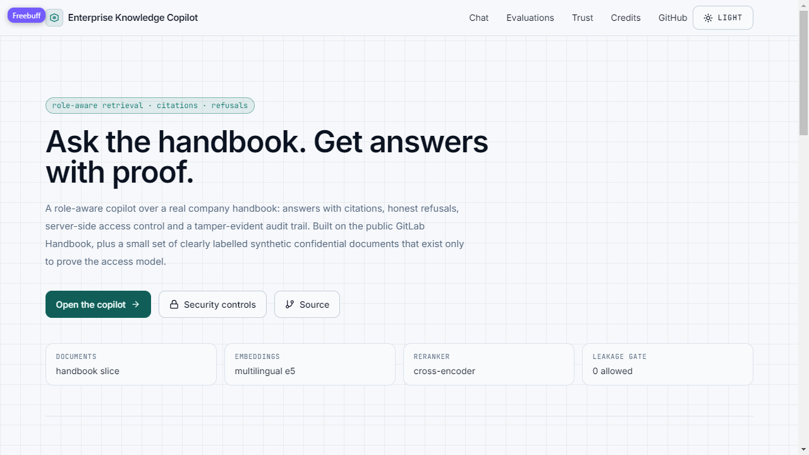
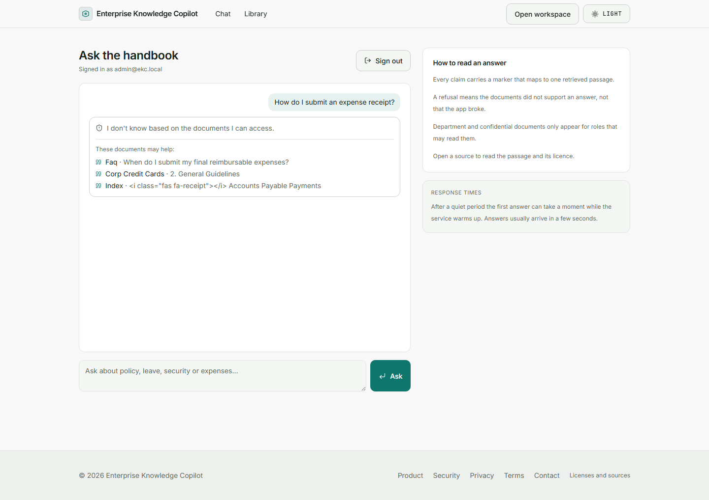
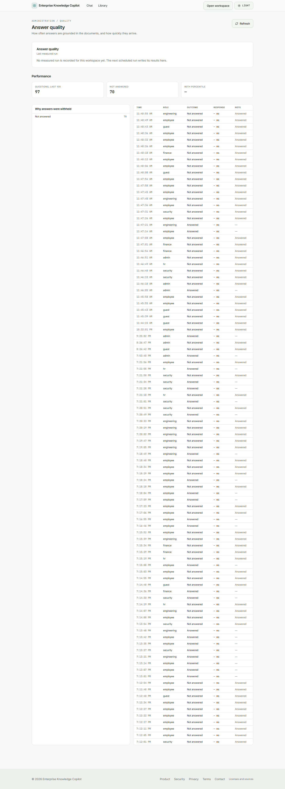
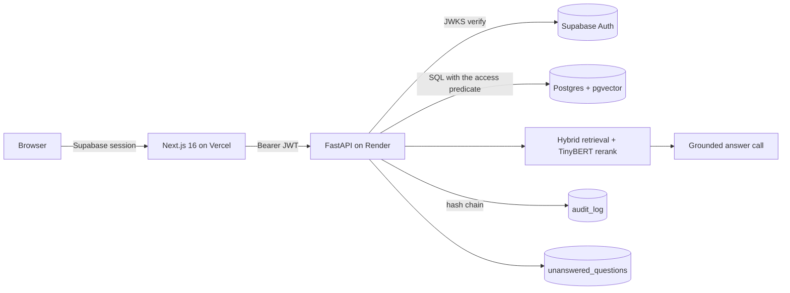

# Enterprise Knowledge Copilot

A knowledge copilot over company documents. People ask a question, get an answer
with the passage it came from, and see only the documents their role may read.
Administrators see where the documents fall short and can close the gap.

**Live product:** https://enterprise-knowledge-copilot-wine.vercel.app

## What a visitor can do

- Open the **sample workspace** from the home page without an account: one click
  signs in as a read-only guest over a public handbook slice.
- Ask a question and open the citation under any claim to see the passage,
  document, section and licence.
- Ask something the documents do not cover: the answer is a refusal with the
  closest sources, and the question is queued for an administrator.
- Sign in with a role account to see the library and, as an administrator, the
  unanswered queue, answer quality, performance and activity log.

## Who can do what

There are eight roles. **Owner** and **Admin** carry management powers; the other
six decide which documents a person may read. Every role is scoped to one
workspace; no role can read another tenant's data.

| Role | Documents it may read | Management it may do |
| --- | --- | --- |
| `guest` | public | none |
| `employee` | public + employee | none |
| `engineering` | public + employee + engineering department | none |
| `security` | public + employee + security department | none |
| `hr` | public + employee + people/HR department | none |
| `finance` | public + employee + finance department | none |
| `admin` | every access level in the workspace, limited to its own groups | groups, invites (not admins), members below admin, documents, analytics, unanswered queue, audit log, diagnostics |
| **owner** | every document in every group | everything an admin can do, plus workspace settings, workspace deletion, and inviting or changing admins |

**Owner** is created by signing up at `/register`; an owner cannot be invited.
Ownership transfer is not implemented. **Admin** can see confidential material
but does not bypass groups, cannot change workspace settings or delete the
workspace, and cannot invite, grant or modify an admin. All signed-in roles can
ask questions, open citations and upload documents where the workspace allows it;
the sample workspace is read-only.

`public` is an access level **inside one workspace**, not the open internet. A
guest sees the public documents of the workspace they belong to; another owner's
workspace is a different tenant and is never searched. Answers come from those
documents, not from other users' past questions or from other workspaces.

The access rule is enforced in the SQL that selects passages, not by hiding a
button in the browser. `docs/WORKING_ON_THIS.md` records the full model.

## What you can ask

The copilot answers from the documents the signed-in account may read. It does not
browse the web, use general knowledge, run code, or answer from another workspace.
When the documents do not contain the answer, it refuses and shows the closest
sources instead of inventing one.

In the sample workspace the corpus is a public slice of the GitLab Handbook. Typical
answerable questions include:

- expenses, receipts and when to use a company credit card;
- onboarding, leave notice, laptops and company values;
- incidents, post-mortems, on-call duties and change freezes;
- code review, test coverage and handling confidential material in a merge request;
- production access, credential rotation, access reviews and vendor access;
- reporting a vulnerability and the security severity matrix.

Department roles add their department's material; admins and owners can ask across
all access levels. Questions work in Bangla or English, and every answer cites the
passage it used.

A newly created workspace starts empty. Upload PDF, DOCX, HTML, Markdown or text
files in the library, wait for indexing to finish, then ask about them. Before that,
the honest answer is a refusal. Questions about live news, personal data, medical
or legal advice, or anything absent from the uploaded documents are outside scope.

## Screenshots

Captured by Playwright from the live deployment on 13 November 2026.

| | |
| --- | --- |
|  |  |
|  | |

More: `docs/screenshots/` (sign-in, dark theme, admin, mobile, product tour).

## Architecture



The permission predicate is part of the SQL that selects chunks, mirrored by RLS.
A post-filter would be a bug.

## Answer quality, measured on both splits

`eval/run_eval.py --split dev|test --cache-tag quality-v6`, full splits, five
seconds between live questions. Final runs: 43575136979 (dev), 43576319480 (test);
initial runs: 43572849666 (dev), 43574067184 (test).

| Metric | Dev initial | Dev final | Test initial | Test final |
| --- | --- | --- | --- | --- |
| retrieval hit@5 | 0.885 | 0.885 | 1.0 | 1.0 |
| retrieval recall@50 | 1.0 | 1.0 | 1.0 | 1.0 |
| retrieval MRR | 0.845 | 0.845 | 0.907 | 0.907 |
| citation hit@k | 0.562 | 0.375 | 0.476 | 0.429 |
| citation precision | 0.360 | 0.240 | 0.294 | 0.265 |
| refusal accuracy | 0.660 | 0.560 | 0.588 | 0.588 |
| wrong refusals | 16 of 32 | 21 of 32 | 12 of 21 | 13 of 21 |
| unanswerable refused | 17 of 18 | 17 of 18 | 11 of 13 | 12 of 13 |
| p50 / p95 latency | 4236 / 5999 ms | 4185 / 6502 ms | 4314 / 5415 ms | 4331 / 5672 ms |
| Permission leakage | **0** | **0** | **0** | **0** (hard gate) |

Provider errors were 0 of 50 and 0 of 34 in both rounds, so all four runs are
valid. A later dev diagnostic run (`quality-v7`, 50 questions) scored 19/32 wrong
refusals with 0.58 refusal accuracy; test has not been re-run since `quality-v6`.
Retrieval did not change. The largest initial group was the 49-character
refusal with no citations while the gold passage ranked first; the grounded call
was given 2600 tokens and low reasoning effort to stop the JSON being truncated.
The final numbers do not improve: dev wrong refusals rose from 16 to 21 and test
from 12 to 13. The fix was not kept as a success, and no second change was made in
this slice. The remaining refusal is model-side, after retrieval, not search or
permissions; the next diagnosis needs the refusal reason and raw reply retained
for each wrong refusal.

## Security controls

Client-facing summary: `/security`. Engineering evidence lives here and in
`docs/reports/security.md`.

| Control | Where it runs | Proof |
| --- | --- | --- |
| Permission leakage | `api/tests/test_retrieval_access.py` | cross-role probes, zero leaked passages |
| Sign-in on production | `.github/workflows/e2e-auth.yml` | Playwright signs in as all seven roles through the form and keeps the session |
| Secret scanning | `.github/workflows/ci.yml` | gitleaks over the full history |
| Code scanning | `.github/workflows/codeql.yml` | CodeQL, TypeScript and Python |
| Container and dependency scan | `.github/workflows/security.yml` | Trivy, pip-audit, `pnpm audit`, SBOM |
| Activity-log integrity | `.github/workflows/audit-integrity.yml` | six-hourly checkpoint verification, weekly full pass, issue opened on failure |
| Action pinning | every workflow | every `uses:` is a commit SHA |

## Stack and why

| Layer | Choice | Why |
| --- | --- | --- |
| Web | Next.js 16 App Router, Tailwind v4 | server components, one deploy target |
| API | FastAPI, Python 3.12, Docker | CPU-only retrieval, portable image |
| Data | Supabase Postgres + pgvector + Auth + RLS | free tier, RLS is the access boundary |
| Retrieval | pgvector + full-text, RRF, TinyBERT cross-encoder | recall and precision on CPU |
| Models | provider router (Groq primary, Gemini backup) | free tiers, no lock-in |
| Embeddings | `bge-small-en-v1.5` ONNX, 384 dims | fits the 512 MB host |

## Running it

```bash
pnpm install
pnpm dev
pnpm lint && pnpm typecheck && pnpm test && pnpm build
pnpm exec playwright test          # needs EKC_DEMO_PASSWORD
node scripts/check-done.mjs
```

Deployment, including the free-tier limits: `docs/DEPLOY.md`. Demo walkthrough:
`docs/DEMO_SCRIPT.md`.

## Limits, measured

- The API runs on a free 512 MB instance: a larger cross-encoder does not fit
  (402 MB RSS before a restart), so ranking uses TinyBERT.
- The free instance sleeps after 15 idle minutes; the ten-minute keep-warm
  workflow hides most of it, and the first answer after a cold start can still
  take a minute.
- Free model quotas throttle. A refused answer caused by a provider outage says
  so in the admin detail instead of pretending the documents lack the answer.
- Generation and refusal, not retrieval, are the current weak point: retrieval
  finds the gold passage at rank 1 for most wrong refusals, while citation
  precision is 0.240 dev / 0.265 test.
- The 84-question set is small; the numbers move by a few points between runs of
  the same configuration. The per-question evidence is retained in
  `docs/reports/eval_dev.json` and `docs/reports/eval_test.json`.
- The free model quotas, cold starts and corpus scope are measured limits, not
  hidden behaviour; the reports name the run behind each number.

## Credits and licences

- Sample documents: [GitLab Handbook](https://handbook.gitlab.com/), licensed
  [CC BY-SA 4.0](https://creativecommons.org/licenses/by-sa/4.0/), attributed per
  document and in the source panel. `/licenses` is the public attribution page.
- Models: see `/licenses` or `docs/PROJECT_FACTS.json`.
- The small confidential set is invented for access-control testing and labelled
  as such in the data, not on the customer-facing pages.
