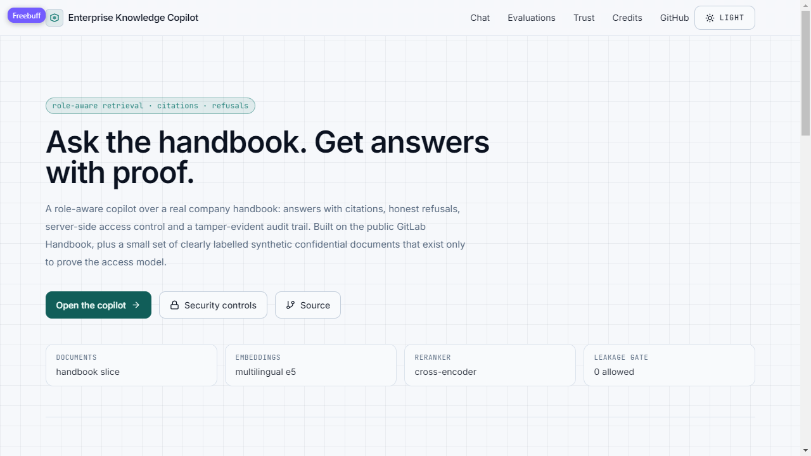
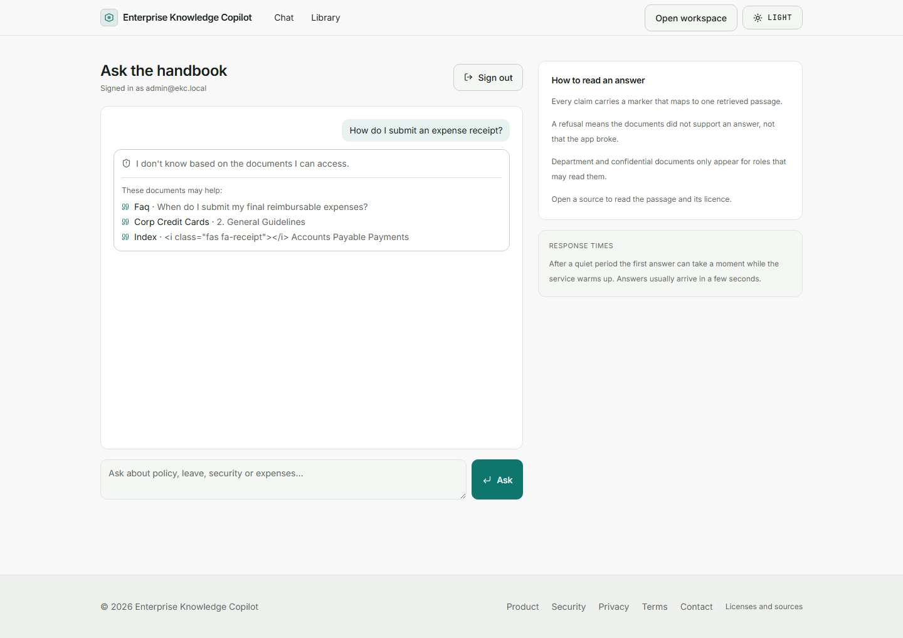
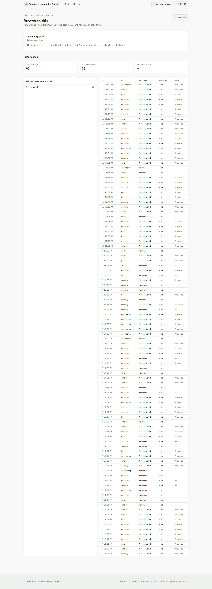
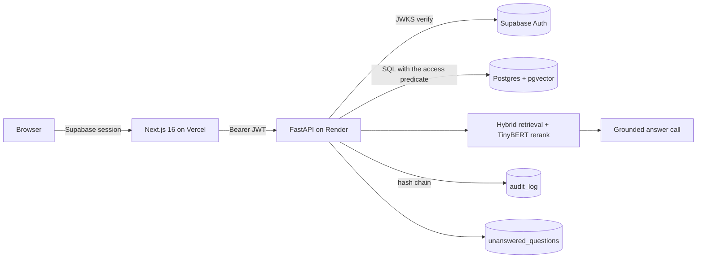

# Enterprise Knowledge Copilot

A knowledge copilot over company documents. People ask a question, get an answer
with the passage it came from, and see only the documents their role may read.
Administrators see where the documents fall short and can close the gap.

**Live product:** https://enterprise-knowledge-copilot-wine.vercel.app
**Repository:** https://github.com/ibrahimSumon47/Enterprise-Knowledge-Copilot

## What a visitor can do

- Open the **sample workspace** from the home page without an account: one click
  signs in as a read-only guest over a public handbook slice.
- Ask a question and open the citation under any claim to see the passage,
  document, section and licence.
- Ask something the documents do not cover: the answer is a refusal with the
  closest sources, and the question is queued for an administrator.
- Sign in with a role account to see the library and, as an administrator, the
  unanswered queue, answer quality, performance and activity log.

## Screenshots

Captured by Playwright from the live deployment on 13 November 2026.

| | |
| --- | --- |
|  |  |
|  |  |

More: `docs/screenshots/` (mobile, dark theme, product tour).

## Architecture



The permission predicate is part of the SQL that selects chunks, mirrored by RLS.
A post-filter would be a bug.

## Answer quality, measured on the held-out test split

`eval/run_eval.py --split test --cache-tag product-v2`, 34 questions (21 answerable,
13 unanswerable); report: `docs/reports/eval_test.json`.

| Metric | Value |
| --- | --- |
| hit@k | 0.036 |
| citation precision | 0.029 |
| refusal accuracy | 0.412 |
| p50 / p95 latency | 3 435 / 4 793 ms |
| Permission leakage | **0** (hard gate) |

The targets were at most three wrong refusals of 21 answerable questions and 90%
of unanswerable questions refused. Both were missed. Two causes are measured:
the cross-encoder's top score sits below the old 0.15 answer floor for about half
the questions, and the grounded prompt usually cites one passage, so a single
non-gold citation scores zero. The floor was lowered to 0.0 and the decision moved
to the grounded call; the run with that configuration was still queued against the
free instance when this document was written, so the numbers above describe the
previous floor. `docs/reports/retrieval_refusals.md` has the retrieval analysis.

## Security controls

Client-facing summary: `/security`. Engineering evidence lives here and in
`docs/reports/security.md`.

| Control | Where it runs | Proof |
| --- | --- | --- |
| Permission leakage | `api/tests/test_retrieval_access.py` | cross-role probes, zero leaked passages |
| Sign-in on production | `.github/workflows/e2e-auth.yml` | Playwright signs in as all seven roles through the form and keeps the session |
| Secret scanning | `.github/workflows/ci.yml` | gitleaks over the full history |
| Code scanning | `.github/workflows/codeql.yml` | CodeQL, TypeScript and Python |
| Container and dependency scan | `.github/workflows/security.yml` | Trivy, pip-audit, `pnpm audit`, SBOM |
| Activity-log integrity | `.github/workflows/audit-integrity.yml` | six-hourly checkpoint verification, weekly full pass, issue opened on failure |
| Action pinning | every workflow | every `uses:` is a commit SHA |

## Stack and why

| Layer | Choice | Why |
| --- | --- | --- |
| Web | Next.js 16 App Router, Tailwind v4 | server components, one deploy target |
| API | FastAPI, Python 3.12, Docker | CPU-only retrieval, portable image |
| Data | Supabase Postgres + pgvector + Auth + RLS | free tier, RLS is the access boundary |
| Retrieval | pgvector + full-text, RRF, TinyBERT cross-encoder | recall and precision on CPU |
| Models | provider router (Groq primary, Gemini backup) | free tiers, no lock-in |
| Embeddings | `bge-small-en-v1.5` ONNX, 384 dims | fits the 512 MB host |

## Running it

```bash
pnpm install
pnpm dev
pnpm lint && pnpm typecheck && pnpm test && pnpm build
pnpm exec playwright test          # needs EKC_DEMO_PASSWORD
node scripts/check-done.mjs
```

Deployment, including the free-tier limits: `docs/DEPLOY.md`. Demo walkthrough:
`docs/DEMO_SCRIPT.md`.

## Limits, measured

- The API runs on a free 512 MB instance: a larger cross-encoder does not fit
  (402 MB RSS before a restart), so ranking uses TinyBERT.
- The free instance sleeps after 15 idle minutes; the ten-minute keep-warm
  workflow hides most of it, and the first answer after a cold start can still
  take a minute.
- Free model quotas throttle. A refused answer caused by a provider outage says
  so in the admin detail instead of pretending the documents lack the answer.
- Retrieval recall, not generation, is the weak point: the test split's hit@k is
  in the table above, and `docs/reports/retrieval_refusals.md` analyses why.
- The 84-question set is small; the numbers move by a few points between runs of
  the same configuration.

## Credits and licences

- Sample documents: [GitLab Handbook](https://handbook.gitlab.com/), licensed
  [CC BY-SA 4.0](https://creativecommons.org/licenses/by-sa/4.0/), attributed per
  document and in the source panel. `/licenses` is the public attribution page.
- Models: see `/licenses` or `docs/PROJECT_FACTS.json`.
- The small confidential set is invented for access-control testing and labelled
  as such in the data, not on the customer-facing pages.
