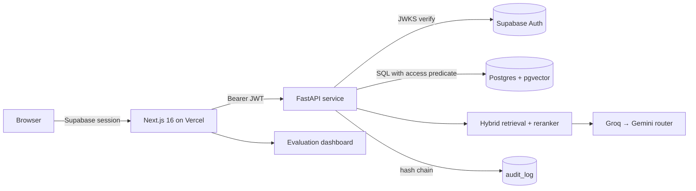

# Enterprise Knowledge Copilot

**Ask the handbook. Get answers with proof.**

[](https://github.com/ibrahimSumon47/Enterprise-Knowledge-Copilot/actions/workflows/ci.yml)
[](https://github.com/ibrahimSumon47/Enterprise-Knowledge-Copilot/actions/workflows/codeql.yml)
[](LICENSE)

A role-aware RAG copilot over a real company handbook: cited answers, honest
refusals, access control enforced inside the database query, a tamper-evident
audit trail and an evaluation suite that measures all of it.

**Live web app:** https://enterprise-knowledge-copilot-wine.vercel.app
**Repository:** https://github.com/ibrahimSumon47/Enterprise-Knowledge-Copilot

## Status (honest)

| Area | State |
| --- | --- |
| Web shell, design system, deploy pipeline | Working, live on Vercel, auto-deploy on `main` |
| Postgres schema, RLS, hybrid retrieval SQL | Written and versioned in `supabase/migrations`, applied by CI |
| FastAPI service (auth, RAG, audit, eval API) | Complete in `api/`, unit-tested; **hosting blocked** — Hugging Face now requires PRO for Docker Spaces (HTTP 402), see `docs/PROJECT_STATE.md` |
| Corpus | 754 documents (871k words) from the public GitLab Handbook + 12 labelled synthetic confidential documents |
| Evaluation set | 84 questions across answerable, unanswerable, Bangla, multi-document and cross-role cases |

The full phase-by-phase state lives in `docs/PROJECT_STATE.md`; feature status
with evidence is in `docs/features.json`.

## What it does

- **Answers with citations.** Every claim carries a `[n]` marker that maps to a
  passage; the source drawer highlights that passage.
- **Refuses honestly.** Below the confidence threshold, or when citation
  verification fails, the copilot says it does not know instead of guessing.
- **Enforces access in SQL.** The role and department predicate is part of the
  query that selects chunks, mirrored by Row Level Security policies.
- **Audits everything.** Questions, refusals, role, document ids and latency go
  into a hash-chained log; a verify action recomputes the chain.
- **Measures quality.** A golden set runs against the deployed API and writes
  `docs/reports/eval.json` and `eval.md`, with permission leakage as a hard gate.

## How access control works

| Role | Public | Employee | Department | Confidential |
| --- | --- | --- | --- | --- |
| Guest / contractor | allow | deny | deny | deny |
| Employee | allow | allow | deny | deny |
| Engineering / security / people / finance | allow | allow | own department | deny |
| Administrator | allow | allow | allow | allow |

Access labels are assigned by this project to demonstrate access control — the
underlying GitLab Handbook is public. The twelve confidential documents are
invented, marked `synthetic` in metadata and labelled in the UI.

## Architecture



Diagrams: `docs/diagrams/` (SVG and PNG).

## Evaluation

Metrics are produced by `eval/run_eval.py` against the deployed API. The current
report is in `docs/reports/eval.md`; numbers are only written there by a real run,
never by hand.

Hard gate: **permission leakage must be exactly 0**.

## Stack and why

| Layer | Choice | Why |
| --- | --- | --- |
| Web | Next.js 16 App Router, Tailwind v4 | server components, streaming, Vercel Hobby |
| API | FastAPI, Python 3.12, Docker | CPU-only RAG, portable image |
| Data | Supabase Postgres + pgvector + Auth + RLS | free tier, RLS is the access boundary |
| Retrieval | pgvector + full-text, RRF, cross-encoder rerank | good recall, CPU-friendly precision |
| LLM | provider router: Groq primary, Gemini backup, mock for tests | free tiers, no lock-in |
| Embeddings | `intfloat/multilingual-e5-small` | Bangla questions over English documents |

## Quick start (reviewer)

```bash
git clone https://github.com/ibrahimSumon47/Enterprise-Knowledge-Copilot.git
cd Enterprise-Knowledge-Copilot
pnpm install
pnpm dev
```

Checks:

```bash
pnpm lint && pnpm typecheck && pnpm test && pnpm build
python -m pytest api/tests -q
python eval/run_eval.py --subset --offline
node scripts/check-done.mjs --phase P0
```

## Limitations

- The API host is blocked on the free tier (see Status). The image is portable;
  any Docker host works with the environment variables in `docs/RUNBOOK.md`.
- Streamed answers are emitted progressively from a single completion; provider
  token streaming is a planned improvement.
- Faithfulness in CI is a deterministic citation-overlap proxy; the LLM judge is
  used only in the manual full run.

## Credits

- Documents: [GitLab Handbook](https://handbook.gitlab.com/), licensed
  [CC BY-SA 4.0](https://creativecommons.org/licenses/by-sa/4.0/). Attribution
  and licence are stored per document and shown in the source drawer and on the
  Credits page.
- Twelve synthetic confidential documents were written for this project and are
  labelled as synthetic wherever they appear.
