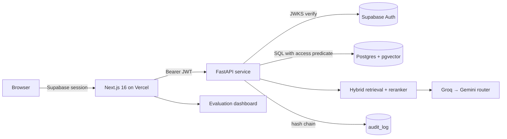
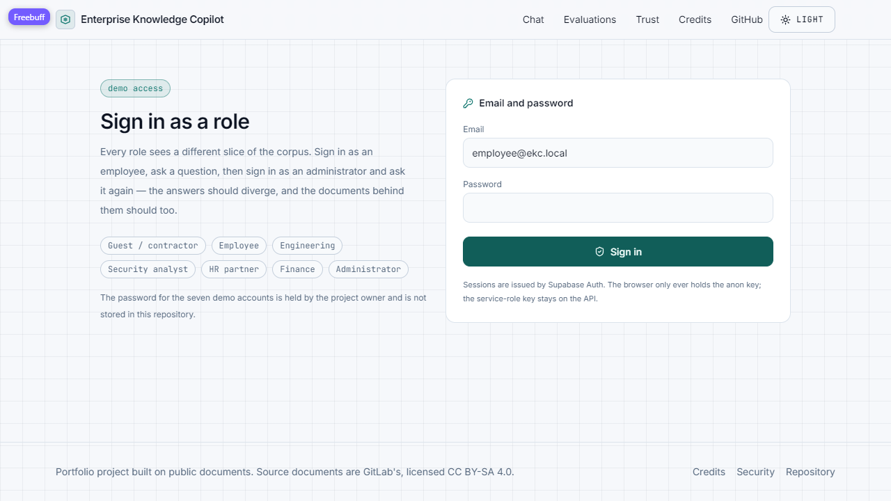
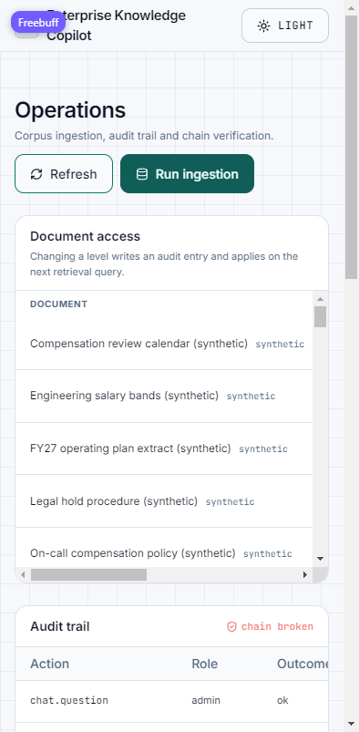

# Enterprise Knowledge Copilot

**Ask the handbook. Get answers with proof.**

[](https://github.com/ibrahimSumon47/Enterprise-Knowledge-Copilot/actions/workflows/ci.yml)
[](https://github.com/ibrahimSumon47/Enterprise-Knowledge-Copilot/actions/workflows/codeql.yml)
[](LICENSE)

A role-aware RAG copilot over a real company handbook: cited answers, honest
refusals, access control enforced inside the database query, a tamper-evident
audit trail and an evaluation suite that measures all of it.

**Live web app:** https://enterprise-knowledge-copilot-wine.vercel.app
**Repository:** https://github.com/ibrahimSumon47/Enterprise-Knowledge-Copilot

## Status (honest)

| Area | State |
| --- | --- |
| Web shell, design system, deploy pipeline | Working, live on Vercel, auto-deploy on `main` |
| Postgres schema, RLS, hybrid retrieval SQL | Written and versioned in `supabase/migrations`, applied by CI |
| FastAPI service (auth, RAG, audit, eval API) | **Live** on Render's free Docker tier (512 MB, ~50 s cold start); see `docs/PROJECT_STATE.md` for the measured limits |
| Corpus | 754 documents (871k words) from the public GitLab Handbook + 12 labelled synthetic confidential documents |
| Memory under load | **386 → 402 MB RSS** with five concurrent retrieval requests and both ONNX models loaded (measured on the deployed 512 MB instance) |
| Evaluation set | 84 questions across answerable, unanswerable, Bangla, multi-document and cross-role cases |

Quality of the last full run: **hit@k 0.406**, citation precision 0.333, refusal
accuracy 0.679, p95 6.7 s, permission leakage **0** over 84 questions. A
model-free run on the test split (no LLM, 3 passes) puts the right document in the
top three for **0.857** of answerable questions, which locates the loss in the
refusal decision rather than in ranking — see `docs/reports/retrieval_eval.md`.
The full phase-by-phase state lives in `docs/PROJECT_STATE.md`; feature status with
evidence is in `docs/features.json`.

## What it does

- **Answers with citations.** Every claim carries a `[n]` marker that maps to a
  passage; the source drawer highlights that passage.
- **Refuses honestly.** Below the confidence threshold, or when citation
  verification fails, the copilot says it does not know instead of guessing.
- **Enforces access in SQL.** The role and department predicate is part of the
  query that selects chunks, mirrored by Row Level Security policies.
- **Audits everything.** Questions, refusals, role, document ids and latency go
  into a hash-chained log; a verify action recomputes the chain.
- **Measures quality.** A golden set runs against the deployed API and writes
  `docs/reports/eval.json` and `eval.md`, with permission leakage as a hard gate.

## How access control works

| Role | Public | Employee | Department | Confidential |
| --- | --- | --- | --- | --- |
| Guest / contractor | allow | deny | deny | deny |
| Employee | allow | allow | deny | deny |
| Engineering / security / people / finance | allow | allow | own department | deny |
| Administrator | allow | allow | allow | allow |

Access labels are assigned by this project to demonstrate access control — the
underlying GitLab Handbook is public. The twelve confidential documents are
invented, marked `synthetic` in metadata and labelled in the UI.

## Architecture



Diagrams: `docs/diagrams/` (SVG and PNG).

## Evaluation

Metrics are produced by `eval/run_eval.py` against the deployed API. The current
report is in `docs/reports/eval.md`; numbers are only written there by a real run,
never by hand.

| Split | Questions | hit@k | precision | refusal acc | p95 | leakage |
| --- | --- | --- | --- | --- | --- | --- |
| full | 84 | 0.406 | 0.333 | 0.679 | 6 687 ms | 0 |
| dev | 50 | 0.415 | 0.340 | 0.680 | 7 100 ms | 0 |

The dev/test split is fixed in `eval/golden_dev.jsonl` / `golden_test.jsonl`; the
sprint that measured recall and the evidence grader is in
`docs/reports/retrieval_sprint.md`.

Hard gate: **permission leakage must be exactly 0**.

### Model-free retrieval evaluation

`eval/retrieval_eval.py` calls `/admin/retrieval?all_candidates=true`, which returns
every scored passage without touching a language model, so ranking and the refusal
decision can be measured even when the free LLM quota is exhausted. Three passes
per split; retrieval is deterministic, so the spread is 0.000.

| Split | Config | hit@3 | hit@10 | MRR | unanswerable refused | separation AUC |
| --- | --- | --- | --- | --- | --- | --- |
| dev (50) | fused only | 0.688 ± 0.000 | 0.719 ± 0.000 | 0.601 ± 0.000 | n/a | n/a |
| dev (50) | + TinyBERT rerank | 0.688 ± 0.000 | 0.781 ± 0.000 | 0.686 ± 0.000 | 0.833 | 0.667 |
| test (34) | fused only | 0.857 ± 0.000 | 0.857 ± 0.000 | 0.833 ± 0.000 | n/a | n/a |
| test (34) | + TinyBERT rerank | 0.857 ± 0.000 | 0.857 ± 0.000 | 0.809 ± 0.000 | 0.846 | 0.687 |

The reranker improves ordering on dev (MRR 0.601 → 0.686) and ties on test; a
blend of fused rank and reranker score was tested and did not beat either
(AUC 0.56–0.60). The refusal threshold sweep on dev found no value that refuses
90% of unanswerable questions while refusing fewer than 19 of 32 answerable ones,
because the top-score distributions overlap (AUC 0.667). That is the measured
limit behind the end-to-end hit@k.

## Stack and why

| Layer | Choice | Why |
| --- | --- | --- |
| Web | Next.js 16 App Router, Tailwind v4 | server components, streaming, Vercel Hobby |
| API | FastAPI, Python 3.12, Docker | CPU-only RAG, portable image |
| Data | Supabase Postgres + pgvector + Auth + RLS | free tier, RLS is the access boundary |
| Retrieval | pgvector + full-text, RRF, cross-encoder rerank | good recall, CPU-friendly precision |
| LLM | provider router: Groq primary, Gemini backup, mock for tests | free tiers, no lock-in |
| Embeddings | `bge-small-en-v1.5` (ONNX, 384 dims, 0.067 GB) | Fits the 512 MB host; Bengali questions are translated to English before embedding |

## Quick start (reviewer)

```bash
git clone https://github.com/ibrahimSumon47/Enterprise-Knowledge-Copilot.git
cd Enterprise-Knowledge-Copilot
pnpm install
pnpm dev
```

Checks:

```bash
pnpm lint && pnpm typecheck && pnpm test && pnpm build
python -m pytest api/tests -q
python eval/run_eval.py --subset --offline
node scripts/check-done.mjs --phase P0
```

## Security controls

Every control links to the workflow or test that proves it. Details:
`docs/reports/security.md`, plus the public `/trust` page.

| Control | Where it runs | Proof |
| --- | --- | --- |
| Secret scanning (full history) | `.github/workflows/ci.yml` (`secrets-scan`) | gitleaks, pinned CLI |
| Code scanning | `.github/workflows/codeql.yml` | CodeQL for TypeScript and Python |
| Container and filesystem scan | `.github/workflows/security.yml` (`trivy`) | Trivy 0.57.1, SARIF to code scanning |
| SBOM | `.github/workflows/security.yml` | CycloneDX `sbom.cdx.json` artifact |
| Python dependency audit | `.github/workflows/security.yml` (`dependencies`) | pip-audit report artifact |
| Node dependency audit | `.github/workflows/security.yml` (`dependencies`) | `pnpm audit --audit-level high` |
| Supply-chain posture | `.github/workflows/security.yml` (`scorecard`) | OpenSSF Scorecard SARIF |
| Action pinning | every workflow | every `uses:` is a commit SHA |
| Permission leakage | `api/tests/test_retrieval_access.py` | guest/employee/department cases |
| Audit chain | `.github/workflows/audit-integrity.yml` | every six hours, `scripts/check_audit_chain.py` fails the run if `/audit/verify` reports a break; `api/tests/test_units.py` covers tampering, windowed pages and jsonb detail |

## Screenshots

Captured from the live deployment on 2026-11-12.

| | |
| --- | --- |
|  |  |
|  |  |

More in `docs/screenshots/`. The showcase script is `docs/showcase/demo-video-script.md`.

## Free-tier limits and cold start

- The API runs on Render's free Docker tier: 512 MB, one shared CPU, and the
  instance sleeps after 15 idle minutes. The first answer after a quiet period
  can take up to a minute while the container starts; `components/warmup-banner.tsx`
  says so in the UI.
- Groq and Gemini free tiers are the LLM source, with a 1.5 s hedge and a 12 s
  cap. When both are exhausted the API returns a refusal with no citations rather
  than an error.
- Cloudflare Workers AI is wired as an optional reranker (`EKC_CLOUDFLARE_ACCOUNT_ID`
  and `EKC_CLOUDFLARE_API_TOKEN`). Its free plan gives 10,000 Neurons a day with no
  card, and `@cf/baai/bge-reranker-base` costs 283 Neurons per million input
  tokens. It was not enabled on the live deployment (no account token) and its
  free-tier terms are documented rather than measured here.

## Limitations

- The API runs on a free 512 MB instance: a bigger cross-encoder does not fit
  (measured at 402 MB RSS before the process died), so re-ranking uses TinyBERT.
- The free instance sleeps; the first request after idle takes ~50 s.
- 14 of 84 questions that should be answerable are refused because the cross-encoder
  scores the correct passage near zero; the analysis is in
  `docs/reports/retrieval_refusals.md`.
- Provider quotas are free-tier: Groq throttles to 429 and the Gemini backup is
  capped at 12 s.
- Streamed answers are emitted progressively from a single completion; provider
  token streaming is a planned improvement.
- Faithfulness in CI is a deterministic citation-overlap proxy; the LLM judge is
  used only in the manual full run.

## Shared accounts and what they may do

Seven role accounts exist so a reviewer can see every access level without
registering. They are shared, so they are constrained:

- passwords live only in the deployment secret, never in the repository;
- the admin account **cannot delete documents** (`DELETE /documents/{id}` answers 403
  and writes a `document.delete_denied` audit entry);
- changes to a document's access level are written to the hash-chained audit log and
  **reversed nightly** by `.github/workflows/reset-admin-edits.yml` against
  `data/access_baseline.json`;
- sign-in is rate-limited and every question, refusal and admin action is audited.

Tests: `api/tests/test_units.py::test_shared_admin_cannot_delete_documents` and
`::test_document_update_is_admin_only`.

## Credits

- Documents: [GitLab Handbook](https://handbook.gitlab.com/), licensed
  [CC BY-SA 4.0](https://creativecommons.org/licenses/by-sa/4.0/). Attribution
  and licence are stored per document and shown in the source drawer and on the
  Credits page.
- Twelve synthetic confidential documents were written for this project and are
  labelled as synthetic wherever they appear.
