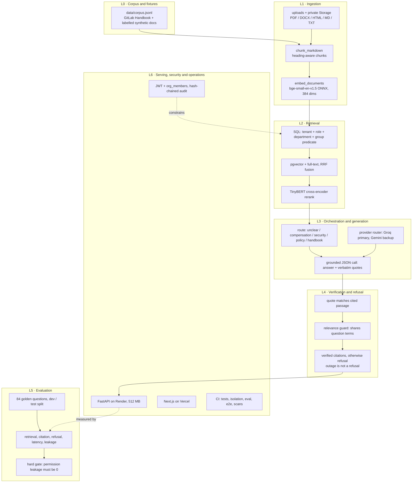

# AI Engineering layer map

This is the architecture map for the part of the product that is **AI engineering**
rather than ordinary web engineering: the path from a document to a cited answer,
and the machinery that keeps that path honest.

The short version: the model is one small box in the middle. Most of the work is
in what the model is allowed to see, what it is allowed to say, and how the result
is checked and measured. That is why the interesting code is around the model,
not in the call itself.

## The map

Read it top to bottom as the life of a document, and right to left at L2–L4 as the
life of a question. The dotted lines are the two loops that make it engineering
instead of a demo: security constrains retrieval, and evaluation measures the
served system.

## Layer by layer

Each layer names its code, the one decision that matters there, and the evidence
that the decision held.

### L0 — Corpus and fixtures

**Code:** `data/corpus.jsonl`, `.corpus-src/`, `docs/DEMO_SCRIPT.md`.

The corpus is the public GitLab Handbook (CC BY-SA 4.0) plus twelve invented
documents that exist to exercise confidential access levels. They are labelled
synthetic in the data, not on customer-facing pages, because they are test
fixtures rather than knowledge.

**Decision that matters:** a retrieval system is only as good as the questions its
corpus can answer. The golden set is written against this corpus, so a corpus
change silently invalidates the numbers unless the evaluation is re-run.

**Evidence:** `/licenses` and the per-document attribution shown with every
citation; `docs/reports/eval_dev.json` and `docs/reports/eval_test.json` name the
corpus they scored.

### L1 — Ingestion

**Code:** `api/app/ingest.py` (`chunk_markdown`, `run_ingest`, `corpus_fingerprint`),
`api/app/uploads.py`, `api/app/storage.py`, `api/app/embeddings.py`
(`embed_documents`).

Markdown is split on headings, long sections are split further, and each chunk
keeps its document, heading and character offsets. Originals go to a private
Storage bucket; the API streams embed and insert them. Uploads are checked by
extension **and** magic bytes, bounded in size and rate, and parsed with bounded
libraries.

**Decision that matters:** chunk boundaries decide what a citation can point at. A
chunk that spans two ideas produces a passage that is half-relevant to two
questions, which later looks like a ranking failure but started here.

**Evidence:** `api/tests/` covers chunking, format checks and limits;
`corpus_fingerprint` lets an operator tell whether the deployed corpus is the one
in `main`; `/health` reports the embedding/reranker state instead of silently
falling back.

### L2 — Retrieval

**Code:** `api/app/retrieval.py` (`retrieve`, `build_context`),
`api/app/db.py` (`search_chunks`), `supabase/migrations/` (the SQL function and
RLS), `api/app/embeddings.py` (`rerank`).

The question is embedded, then one SQL call returns candidate chunks using
pgvector similarity and full-text search fused with reciprocal rank fusion. The
SQL function applies the organisation, role, department and group predicate
**inside the query**. Candidates are reranked by a TinyBERT cross-encoder, cut at a
minimum score, reduced to one passage per document, and numbered for citation.

**Decision that matters:** permission is a predicate in the query, not a filter
after it. The browser never chooses its tenant or role; both come from the
verified token and the `org_members` row. A post-filter is a bug even when the
visible result looks right.

**Evidence:** `api/tests/test_org_scope.py` proves the tenant comes from the
membership row, not a forged claim or request header, and that search passes that
org into the SQL function; `supabase/tests/cross_tenant.sql` and the isolation workflow
create two real workspaces and attack uploads, invites, groups, deactivation and
retrieval; the evaluation's leakage gate is a hard zero.

### L3 — Orchestration and generation

**Code:** `api/app/pipeline.py` (`classify`, `build_graph`, `answer_question`),
`api/app/providers.py` (`ProviderRouter`, `GroqProvider`, `GeminiProvider`).

The graph runs `route → retrieve → grade → evidence_grade → answer`. Short or
unclear questions are refused before retrieval; Bengali questions are translated
to English for retrieval but answered in the language asked. A low reranker score
is not an automatic refusal — a small grader call gives a second opinion on the
top passages, and it is allowed to say yes or no, never to write the answer. The
answer call receives numbered passages and must reply with JSON containing an
answer and verbatim evidence quotes.

**Decision that matters:** the model is a writer over supplied evidence, not a
knowledge source. It cannot browse, run code or import general knowledge, and the
provider router keeps that interface independent of one vendor: Groq is primary,
Gemini is a hedged backup, and model ids live in configuration.

**Evidence:** `api/tests/` covers routing, JSON parsing and provider failure;
`docs/adr/0001-stack.md` records why this shape; `/health` shows which providers
are configured, and the audit detail records which one answered.

### L4 — Verification and refusal

**Code:** `api/app/pipeline.py` (`parse_grounded_reply`, `verify_evidence`,
`quote_matches`, `closest_sources`, `REFUSAL`, `TEMPORARY_UNAVAILABLE`).

Every quote the model returns is normalised and checked against the exact passage
it claims to cite, then checked against the question terms. Only verified quotes
become citations. If verification fails, the answer becomes an honest refusal with
the closest real sources. If no provider responded, the result is
`temporarily_unavailable` with the provider trace, not a refusal that implies the
documents lack the answer.

**Decision that matters:** a citation is a claim that is checked, not a string the
model produced. This layer is why the product can show an unflattering refusal
rate and still be trustworthy: the failure mode is visible instead of papered over
by invented sources.

**Evidence:** regression tests in `api/tests/` for whitespace, case, ellipses,
light paraphrase, fabricated quotes and unrelated quotes; the evaluation splits
wrong refusals by cause (quote verification, empty evidence, provider error,
relevance guard) instead of reporting one aggregate.

### L5 — Evaluation

**Code:** `eval/run_eval.py`, `eval/golden_set.jsonl`, `golden_dev.jsonl`,
`golden_test.jsonl`, `eval/retrieval_eval.py`, `eval/diagnose.py`,
`docs/reports/eval_*.json`.

Fifty dev questions and thirty-four held-back test questions run against the
deployed API. The harness caches answers by `--cache-tag`, throttles live calls,
refuses to publish a run above 5% provider errors, records the provider, retrieval
rank, refusal outcome and latency per question, and fails the run if any citation
crosses the caller's access level.

**Decision that matters:** dev is for iterating, test is run once after a decision.
A run without a fresh cache tag re-scores old answers and is not evidence.

**Evidence:** current matched numbers in `README.md` and
`docs/PROJECT_STATE.md`; retrieval hit@5 is 0.885 dev / 1.0 test, citation
precision 0.240 / 0.265, refusal accuracy 0.560 / 0.588, permission leakage 0 on
both splits. The reports keep the per-question rows and the failed experiment.

### L6 — Serving, security and operations

**Code:** `api/app/main.py`, `api/app/auth.py`, `api/app/audit.py`,
`api/app/redact.py`, `app/`, `lib/`, `.github/workflows/`.

FastAPI verifies the Supabase JWT against JWKS, loads the active membership, and
serves chat, upload, library, admin and evaluation endpoints. Every important
action is written to a hash-chained audit log, verified from a checkpoint every six
hours and from genesis weekly. Next.js serves the public site and the authenticated
app; it never talks to Postgres directly.

**Decision that matters:** the AI path is treated as an untrusted component inside
a normal security envelope. Logs, rate limits, audit integrity, secret scanning,
pinned actions and reproducible deploys are not AI features, but the AI features
are only usable because they exist.

**Evidence:** the workflow table in `README.md`; `/health.commit` identifies the
deployed build; `docs/THREAT_MODEL.md` records the boundaries.

## What each layer contributes — and what breaks without it

| Layer | Contribution to answer quality | If it were missing |
| --- | --- | --- |
| L0 corpus | the knowledge | nothing to retrieve; every question refused |
| L1 ingestion | retrievable, citable units | passages that cannot be quoted precisely |
| L2 retrieval | finds the right passage under the right permissions | wrong or leaked evidence |
| L3 orchestration | turns passages into a language-shaped answer | no answer, or an unconstrained one |
| L4 verification | makes the citation true | confident answers with invented sources |
| L5 evaluation | tells you whether a change helped | opinions instead of measurements |
| L6 serving | makes all of it reachable and observable | a notebook, not a product |

Retrieval and verification are where this project is strongest; generation is
where it is weakest. The numbers say so plainly: the gold passage is found for
most wrong refusals, and the refusal happens after retrieval. That is a model-side
problem, and the layer map is what stops it from being misdiagnosed as a search or
permission problem.

## Where a change belongs

| You are changing... | Layer | Minimum evidence |
| --- | --- | --- |
| chunk boundaries, a parser, an upload format | L1 | API tests, re-ingest, a retrieval sanity check |
| the SQL predicate, roles, groups, RLS | L2 | DB migrate workflow + cross-tenant isolation workflow |
| embeddings, reranker, candidate pool | L2 | API tests + full dev evaluation with a new cache tag |
| routing, prompts, output schema, providers | L3 | API tests + full dev evaluation, then one test run |
| quote checking, relevance guard, refusal copy | L4 | API tests for both directions, then evaluation |
| golden questions, metrics, gates | L5 | a reproducible run id and updated reports |
| auth, audit, deploy, CI | L6 | the matching workflow green, `/health.commit` matches |

The rule behind the table: a change is judged by the layer it can break, not by
the layer it edits.

## One question, traced through the layers

1. **L6** — the browser sends the question with its Supabase bearer token.
2. **L6** — FastAPI verifies the JWT, loads `org_members`, and derives org, role,
   department and group. A missing or inactive membership is a 403.
3. **L3** — `classify` routes the question; a Bengali question is translated for
   retrieval only.
4. **L2** — `retrieve` embeds the query and calls `search_chunks`, where the
   permission predicate runs inside SQL; RRF fuses the vector and text lists.
5. **L2** — TinyBERT reranks, the score cut and one-passage-per-document rule
   apply, and the survivors are numbered `[1]…[n]`.
6. **L3** — the grounded call returns JSON with an answer and evidence quotes;
   a provider failure here becomes `temporarily_unavailable`.
7. **L4** — each quote is matched against its cited passage and against the
   question terms; only verified quotes survive as citations, otherwise the answer
   is refused with the closest sources.
8. **L6** — the answer, citations, provider, reason and latency are audited; a
   refusal is queued for an administrator.
9. **L5** — the same path, run over the golden set, produces the numbers above.

## Scope of this map

This document covers the AI path and the envelope around it. It does not restate
the role matrix (`README.md`), the request-level operating rules
(`docs/WORKING_ON_THIS.md`), the deployment steps (`docs/DEPLOY.md`) or the
threat model (`docs/THREAT_MODEL.md`). Where this map and those disagree, those
are the source of truth and this file is the bug.
